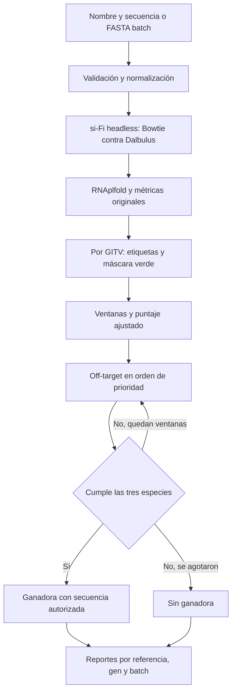

[README_COMPLETO.md](https://github.com/user-attachments/files/34158168/README_COMPLETO.md)
# RNAi en *Dalbulus maidis*: si-Fi y rnai-designer
Proyecto para explorar regiones candidatas de RNA de doble cadena (dsRNA), integrar predicciones de siRNAs y priorizar ventanas en investigación de RNAi en *Dalbulus maidis*.

**El puntaje es una prioridad heurística: no representa eficacia experimental ni una garantía de seguridad biológica o ambiental.**

## Índice
- [Componentes](#componentes)
- [Características](#características)
- [Pipeline](#pipeline)
- [Estructura](#estructura)
- [Instalación](#instalación)
- [Configuración de bases de datos](#configuración-de-bases-de-datos)
- [Uso individual y batch](#uso-individual-y-batch)
- [Puntuación y selección](#puntuación-y-selección)
- [Resultados](#resultados)
- [Limitaciones](#limitaciones)
- [Documentación técnica](docs/README.md)
- [Créditos y licencias](docs/creditos-y-licencias.md)

## Componentes
| Componente | Función | Procedencia |
|---|---|---|
| [si-Fi original](siFi21--1.2.3/README.md) | Diseño de dsRNA, métricas originales de eficiencia/accesibilidad y utilidades gráficas | Software de terceros; versión declarada **v1.2.3-0008** |
| [rnai-designer](rnai-designer/README.md) | CLI Python 3, integración headless, ventanas, off-target, ranking, batch y trazabilidad | Desarrollo propio de integración; versión declarada **0.3.0** |

La carpeta local se llama `siFi21--1.2.3`; los autores denominan el software **siFi** en su README. Las extensiones del proyecto no deben atribuirse a los autores de si-Fi.

## Características
- Entrada por nombre y secuencia, o mediante FASTA multigen en batch.
- Procesamiento separado de todos los main targets GITV detectados, sin recorte arbitrario por número de hits.
- Ventanas verdes con coordenadas trazables; distinción entre regiones cortas y ventanas convencionales.
- Puntaje original con 75 % eficiencia si-Fi y 25 % GC; diversidad descriptiva y de desempate, penalización por longitud y calidad de evidencia independiente.
- Selección sucesiva hasta encontrar una ventana que cumpla el criterio off-target en humano, maíz y abeja.
- Reportes JSON/CSV, gráficos SVG/PNG, evidencia de alineamientos y reanudación por gen en batch.
- Reutilización temporal de cálculos por gen y tablas compactas, sin paralelismo con si-Fi.

## Pipeline


El filtro del gen completo y el de una ventana tienen alcances distintos. Véanse los [criterios científicos](docs/criterios-cientificos.md).

## Estructura
```text
.
├── README.md
├── docs/                       # Guía técnica del proyecto completo
├── siFi21--1.2.3/               # Software original de terceros
└── rnai-designer/
    ├── rnai_designer/          # Python 3 y puente legado
    ├── docs/                  # Auditorías y guías especializadas anteriores
    ├── examples/              # Fixtures ficticios y configuración de ejemplo
    ├── inputs/                # FASTA de entrada
    ├── output/                # Resultados locales, excluidos de Git
    ├── tests/
    ├── benchmarks/
    ├── pyproject.toml
    └── requirements*.txt
```

Las bases y los ejecutables externos se localizan mediante configuración. Su presencia local no implica permiso de redistribución.

## Instalación

El proyecto utiliza **dos entornos distintos**: Python 2.7 de 32 bits para el si-Fi21 original y Python 3.10 o posterior para `rnai-designer`. Los comandos siguientes están pensados para **Windows**. Las rutas son relativas a la raíz del repositorio, sin depender de la ubicación en el disco.

### 1. Instalar Miniforge y preparar si-Fi21 (Python 2.7, 32 bits)

1. Descargar e instalar [Miniforge](https://github.com/conda-forge/miniforge#install) siguiendo la sección **Install**.
2. Abrir **Miniforge Prompt** (terminal de tipo CMD, no PowerShell).
3. Crear y activar el entorno heredado:

```bat
set CONDA_FORCE_32BIT=1
conda create -n sifi_32bit python=2.7 pyqt=4 -c free -c defaults -y
conda activate sifi_32bit
```

> **Compatibilidad:** Python 2.7, PyQt4 y los paquetes de 32 bits están obsoletos. Este comando documenta la configuración utilizada en el proyecto, pero su instalación puede fallar según la plataforma, los canales disponibles y la versión de Conda. `CONDA_FORCE_32BIT` se establece en esa sesión de **CMD**; no es la sintaxis de PowerShell.

### 2. Habilitar Conda en PowerShell (opcional)

Si se va a usar PowerShell, ejecutar una vez en una ventana de **PowerShell**:

```powershell
Set-ExecutionPolicy -ExecutionPolicy RemoteSigned -Scope CurrentUser
```

Luego, desde **Miniforge Prompt**:

```bat
conda init powershell
```

Cerrar y volver a abrir PowerShell antes de utilizar `conda activate`. La configuración de la política de ejecución es una modificación de seguridad del usuario de Windows: realizarla solamente si es necesaria y está permitida por las políticas del equipo.

### 3. Abrir y ejecutar el si-Fi original desde VS Code

En **Miniforge Prompt**, con el entorno legado activado, ubicarse en la **raíz del repositorio clonado** y abrir la carpeta de si-Fi:

```bat
conda activate sifi_32bit
cd siFi21--1.2.3
code .
```

Si `code` no se reconoce, abrir esa carpeta manualmente desde VS Code. En la terminal integrada de VS Code, verificar que esté seleccionado el entorno `sifi_32bit`; después, dentro de `siFi21--1.2.3/`:

```powershell
python -m pip install seaborn matplotlib biopython numpy pillow
python main.py
```

Estas dependencias adicionales son las indicadas para la instalación local; otras dependencias o versiones compatibles pueden ser necesarias para Python 2.7. No se garantiza que las versiones más recientes de los paquetes admitan ese Python antiguo. Los ejecutables Bowtie y RNAplfold, así como sus índices, se configuran por separado.

### 4. Instalar `rnai-designer` (Python 3)

Desde la **raíz del repositorio** en PowerShell, con Python 3.10 o posterior disponible (fuera del entorno `sifi_32bit`):

```powershell
cd rnai-designer
python -m venv .venv
.\.venv\Scripts\python.exe -m pip install -e .
.\.venv\Scripts\python.exe -m rnai_designer doctor
```

**¿Por qué instalar `rnai-designer` si el código ya está en el repositorio?** No se descarga otro programa: `python -m pip install -e .` registra **este mismo proyecto** como paquete editable e instala las dependencias declaradas en `pyproject.toml`. Los cambios al código fuente se reflejan sin tener que reinstalarlo. El entorno `.venv` aísla las dependencias de Python 3 de las del si-Fi21 original en Python 2.7.

El comando `python -m rnai_designer doctor` comprueba la configuración y los requisitos que la herramienta es capaz de diagnosticar; no instala bases ni ejecutables por sí mismo. Si el entorno Python 3 ya tiene todas las dependencias, puede ejecutarse `python -m rnai_designer ...` desde `rnai-designer/` sin instalación editable, pero para reproducibilidad se recomienda el método anterior.

El workflow completo requiere además el entorno legado de si-Fi, Bowtie clásico, RNAplfold y los índices biológicos. **No se instalan automáticamente con `pip`.**

Consultar [instalación y reproducibilidad](docs/instalacion-y-reproducibilidad.md) para versiones verificadas, dependencias y datos pendientes. No ejecutar instalaciones ni diagnósticos sobre el entorno de un batch activo.

## Configuración de bases de datos

**La instalación del software no incluye automáticamente las referencias biológicas.** Antes de utilizar el workflow completo, hay que obtener y configurar tanto el transcriptoma de *Dalbulus maidis* como las referencias de organismos no objetivo. Registrar para cada base su **fuente, versión/fecha, organismo y archivo de origen**; cambiar la referencia puede cambiar los resultados.

### 1. Transcriptoma de *Dalbulus maidis* en si-Fi21

si-Fi21 necesita una base de secuencias de referencia para comparar los siRNAs y mostrar las coincidencias en los transcritos. Para reproducir los análisis del proyecto debe utilizarse el **transcriptoma de *Dalbulus maidis* correspondiente a la investigación**, y no sustituirlo silenciosamente por otro ensamblado o por el genoma.

1. Obtener el archivo **FASTA del transcriptoma** con su procedencia documentada.
2. Activar `sifi_32bit`, abrir si-Fi21 con `python main.py` desde `siFi21--1.2.3/` y acceder a su **administración de bases de datos**.
3. Importar/registrar allí el FASTA mediante las opciones de si-Fi21 y generar el índice **Bowtie** cuando la interfaz lo requiera. Los nombres exactos de las opciones pueden variar con la versión instalada.
4. Comprobar que la referencia se pueda **seleccionar en si-Fi21** y que los índices asociados existan en la ubicación esperada.

> **Importante:** tener un FASTA guardado en una carpeta no equivale a tener una base preparada para Bowtie. Para usar el mismo análisis del proyecto, deben coincidir también la versión de la referencia y la configuración de búsqueda.

### 2. Referencias off-target de `rnai-designer`

El filtro adicional de `rnai-designer` consulta referencias de **humano** (*Homo sapiens*), **maíz** (*Zea mays*) y **abeja** (*Apis mellifera*). Se deben obtener las referencias utilizadas por el proyecto, preparar los índices compatibles con el Bowtie configurado y establecer sus **rutas/prefijos de índice** en la configuración de la herramienta. La ubicación exacta de los parámetros depende del archivo de configuración y de la versión del repositorio; consultar [instalación y reproducibilidad](docs/instalacion-y-reproducibilidad.md) y [criterios científicos](docs/criterios-cientificos.md).

**Cargar *Dalbulus* en si-Fi21 no configura automáticamente estas otras tres referencias.** Tampoco se debe interpretar la disponibilidad de una base como una validación de seguridad biológica.

### 3. Verificar la configuración

Desde la carpeta `rnai-designer/` y utilizando Python 3:

```powershell
.\.venv\Scripts\python.exe -m rnai_designer doctor
```

Revisar cualquier dependencia, ejecutable, ruta o índice que aparezca como faltante. El diagnóstico puede no comprobar todos los aspectos científicos de cada base de datos.

**No subir a GitHub los FASTA o índices voluminosos sin revisar tamaño, licencias y permisos de redistribución.** El README debe documentar de dónde obtenerlos y cómo configurarlos; las bases de datos locales pueden quedar fuera del control de versiones.

## Uso individual y batch
Los ejemplos se ejecutan desde `rnai-designer/`. Con un entorno Python 3 adecuado activo, puede sustituir `.\.venv\Scripts\python.exe` por `python`.

### Un gen
```powershell
.\.venv\Scripts\python.exe -m rnai_designer MiGen "SECUENCIA_IUPAC_COMPLETA"
```

Reemplace el marcador por la secuencia completa de nucleótidos; no es una secuencia ejecutable. El comando recibe exactamente dos argumentos y crea un FASTA y una carpeta de salida corta correlativa. El nombre completo queda en los metadatos. El resumen compacto muestra la secuencia únicamente si el filtro la autoriza.

Con un FASTA existente y una carpeta de salida nueva:

```powershell
.\.venv\Scripts\python.exe -m rnai_designer workflow --gene-id MiGen --sequence-file inputs/MiGen.fasta --out output/MiGen_revision --run-sifi-headless
```

`inputs/MiGen.fasta` es una ruta ilustrativa que debe proporcionar el usuario. `workflow` conserva opciones como `--verbose-report`, `--config`, `--main-target` y `--length-penalty-weight`.

### Varios genes
```powershell
.\.venv\Scripts\python.exe -m rnai_designer batch genes.fasta
```

Formato de entrada, con secuencias cortas exclusivamente ilustrativas, no candidatas científicas:

```fasta
>Gen_A
ACGTACGTACGT
>Gen_B
TGCATGCATGCA
```

Para un análisis real, use las secuencias completas con procedencia documentada. Se crea `output/batch_1/` o el siguiente número libre. Para reanudar:

```powershell
.\.venv\Scripts\python.exe -m rnai_designer batch --resume output/batch_1
```

No iniciar dos procesos sobre la misma carpeta. [Batch, estados y ranking](docs/batch-y-reportes.md).

## Puntuación y selección
El puntaje original de cada ventana utiliza las fracciones que ya calcula el programa, con valores entre 0 y 1:

| Métrica | Peso en el puntaje original | Definición |
|---|---:|---|
| Eficiencia predicha por si-Fi21 | **75 %** | Fracción de siRNAs clasificados como eficientes entre aquellos con clasificación evaluable |
| GC de los siRNAs | **25 %** | Fracción de siRNAs con GC individual entre **30 % y 52 %**, entre aquellos con GC válido |
| Diversidad | **0 %** | Se sigue calculando y exportando; conserva su participación en los desempates |

```text
efficacy_priority_score = 100 × (0,75 × efficiency_fraction + 0,25 × gc_fraction)
```

El componente GC conserva su criterio original: no es el porcentaje GC de toda la ventana, que se informa por separado. No se imputan métricas faltantes. La calidad de evidencia también permanece separada del puntaje.

Después se aplica la penalización por longitud existente, sin cambiar su fórmula ni sus umbrales:

```text
length_penalty = 30 × max(0, 1 - length_nt / 180)
adjusted_priority_score = max(0, efficacy_priority_score - length_penalty)
```

El peso predeterminado de la penalización es **30 puntos** y se conserva su configuración mediante `workflow --length-penalty-weight`. Desde **180 nt**, la penalización vale cero. No impone por sí misma una longitud mínima ni garantiza que gane la ventana más larga.

Las ventanas se ordenan por puntaje ajustado y conservan los desempates existentes: fracción eficiente, fracción GC objetivo, diversidad, calidad de evidencia, inicio, longitud e identificador de región. La diversidad puede resolver un empate aunque tenga peso cero en la fórmula.

El workflow prueba las candidatas en ese orden hasta encontrar una que cumpla el filtro off-target en humano, maíz y abeja. Si ninguna lo acredita, no hay ganadora ni secuencia publicada. Este filtro no suma ni resta puntos y el ranking batch utiliza los puntajes ajustados de las ganadoras aprobadas.

Los nombres de campos y columnas de JSON y CSV se mantienen. Los resultados anteriores conservan los valores de su ejecución y no se recalculan al actualizar la documentación. Para conocer la fórmula de un resultado histórico, consulte sus metadatos.

La puntuación es heurística y **no representa un porcentaje de eficacia experimental**. Detalles de las métricas y controles: [criterios científicos](docs/criterios-cientificos.md).

## Resultados
| Nivel | Archivos principales |
|---|---|
| Referencia GITV | `integrated/report.json`, `window_selection/all_windows.csv`, `selection_report.json`, `selected_window.json` si hay ganadora |
| Gen multirreferencia | `pipeline_result.json`, `reference_comparison.json`, `all_references_windows.csv` |
| Batch | `resultados_genes.csv`, `ranking_genes.csv`, `resumen_batch.json` |

Las rutas completas y la interpretación de cada archivo están en el [mapa de reportes](docs/batch-y-reportes.md#mapa-de-archivos). JSON conserva más detalle que la consola.

## Limitaciones
- El puntaje `/100` no es un porcentaje de silenciamiento ni una predicción validada de eficacia.
- Las zonas verdes reflejan la lógica y la base de si-Fi, no especificidad universal.
- El criterio off-target se limita a coincidencias exactas de 21 nt en los índices consultados.
- Los nombres GITV y prefijos de bases no certifican taxonomía, ensamblado ni versión.
- Cientos de referencias y muchas ventanas rechazadas pueden generar tiempos y volúmenes de archivos muy grandes, incluso con caché.
- Python 2.7, PyQt4, rutas largas y ejecutables antiguos condicionan la portabilidad.

Consulte [rendimiento y problemas conocidos](docs/rendimiento-y-limitaciones.md). No se ha identificado una licencia propia para `rnai-designer`; revise los [créditos y permisos pendientes](docs/creditos-y-licencias.md) antes de distribuir componentes.
