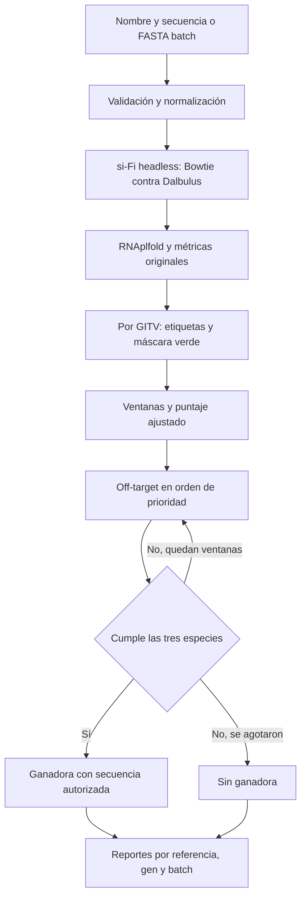

[README_github_limpio.md](https://github.com/user-attachments/files/34157436/README_github_limpio.md)
# RNAi en *Dalbulus maidis*: si-Fi y rnai-designer
Proyecto para explorar regiones candidatas de RNA de doble cadena (dsRNA), integrar predicciones de siRNAs y priorizar ventanas en investigación de RNAi en *Dalbulus maidis*.

**El puntaje es una prioridad heurística: no representa eficacia experimental ni una garantía de seguridad biológica o ambiental.**

## Índice
- [Componentes](#componentes)
- [Características](#características)
- [Pipeline](#pipeline)
- [Estructura](#estructura)
- [Instalación](#instalación)
- [Uso individual y batch](#uso-individual-y-batch)
- [Puntuación y selección](#puntuación-y-selección)
- [Resultados](#resultados)
- [Limitaciones](#limitaciones)
- [Documentación técnica](docs/README.md)
- [Créditos y licencias](docs/creditos-y-licencias.md)

## Componentes
| Componente | Función | Procedencia |
|---|---|---|
| [si-Fi original](siFi21--1.2.3/README.md) | Diseño de dsRNA, métricas originales de eficiencia/accesibilidad y utilidades gráficas | Software de terceros; versión declarada **v1.2.3-0008** |
| [rnai-designer](rnai-designer/README.md) | CLI Python 3, integración headless, ventanas, off-target, ranking, batch y trazabilidad | Desarrollo propio de integración; versión declarada **0.3.0** |

La carpeta local se llama `siFi21--1.2.3`; los autores denominan el software **siFi** en su README. Las extensiones del proyecto no deben atribuirse a los autores de si-Fi.

## Características
- Entrada por nombre y secuencia, o mediante FASTA multigen en batch.
- Procesamiento separado de todos los main targets GITV detectados, sin recorte arbitrario por número de hits.
- Ventanas verdes con coordenadas trazables; distinción entre regiones cortas y ventanas convencionales.
- Puntaje original con 75 % eficiencia si-Fi y 25 % GC; diversidad descriptiva y de desempate, penalización por longitud y calidad de evidencia independiente.
- Selección sucesiva hasta encontrar una ventana que cumpla el criterio off-target en humano, maíz y abeja.
- Reportes JSON/CSV, gráficos SVG/PNG, evidencia de alineamientos y reanudación por gen en batch.
- Reutilización temporal de cálculos por gen y tablas compactas, sin paralelismo con si-Fi.

## Pipeline


El filtro del gen completo y el de una ventana tienen alcances distintos. Véanse los [criterios científicos](docs/criterios-cientificos.md).

## Estructura
```text
.
├── README.md
├── docs/                       # Guía técnica del proyecto completo
├── siFi21--1.2.3/               # Software original de terceros
└── rnai-designer/
    ├── rnai_designer/          # Python 3 y puente legado
    ├── docs/                  # Auditorías y guías especializadas anteriores
    ├── examples/              # Fixtures ficticios y configuración de ejemplo
    ├── inputs/                # FASTA de entrada
    ├── output/                # Resultados locales, excluidos de Git
    ├── tests/
    ├── benchmarks/
    ├── pyproject.toml
    └── requirements*.txt
```

Las bases y los ejecutables externos se localizan mediante configuración. Su presencia local no implica permiso de redistribución.

## Instalación
Desde la raíz Git, en PowerShell, con Python 3.10 o posterior:

```powershell
cd rnai-designer
python -m venv .venv
.\.venv\Scripts\python.exe -m pip install -e .
.\.venv\Scripts\python.exe -m rnai_designer doctor
```

Esto instala la capa Python 3. El workflow completo requiere además Conda, el entorno Python 2.7 de si-Fi, Bowtie clásico, RNAplfold y los índices biológicos. No se instalan automáticamente con pip.

Consulte [instalación y reproducibilidad](docs/instalacion-y-reproducibilidad.md) para conocer versiones verificadas, dependencias y datos pendientes. No ejecutar instalaciones ni diagnósticos sobre el entorno de un batch activo.

## Uso individual y batch
Los ejemplos se ejecutan desde `rnai-designer/`. Con un entorno Python 3 adecuado activo, puede sustituir `.\.venv\Scripts\python.exe` por `python`.

### Un gen
```powershell
.\.venv\Scripts\python.exe -m rnai_designer MiGen "SECUENCIA_IUPAC_COMPLETA"
```

Reemplace el marcador por la secuencia completa de nucleótidos; no es una secuencia ejecutable. El comando recibe exactamente dos argumentos y crea un FASTA y una carpeta de salida corta correlativa. El nombre completo queda en los metadatos. El resumen compacto muestra la secuencia únicamente si el filtro la autoriza.

Con un FASTA existente y una carpeta de salida nueva:

```powershell
.\.venv\Scripts\python.exe -m rnai_designer workflow --gene-id MiGen --sequence-file inputs/MiGen.fasta --out output/MiGen_revision --run-sifi-headless
```

`inputs/MiGen.fasta` es una ruta ilustrativa que debe proporcionar el usuario. `workflow` conserva opciones como `--verbose-report`, `--config`, `--main-target` y `--length-penalty-weight`.

### Varios genes
```powershell
.\.venv\Scripts\python.exe -m rnai_designer batch genes.fasta
```

Formato de entrada, con secuencias cortas exclusivamente ilustrativas, no candidatas científicas:

```fasta
>Gen_A
ACGTACGTACGT
>Gen_B
TGCATGCATGCA
```

Para un análisis real, use las secuencias completas con procedencia documentada. Se crea `output/batch_1/` o el siguiente número libre. Para reanudar:

```powershell
.\.venv\Scripts\python.exe -m rnai_designer batch --resume output/batch_1
```

No iniciar dos procesos sobre la misma carpeta. [Batch, estados y ranking](docs/batch-y-reportes.md).

## Puntuación y selección
El puntaje original de cada ventana utiliza las fracciones que ya calcula el programa, con valores entre 0 y 1:

| Métrica | Peso en el puntaje original | Definición |
|---|---:|---|
| Eficiencia predicha por si-Fi21 | **75 %** | Fracción de siRNAs clasificados como eficientes entre aquellos con clasificación evaluable |
| GC de los siRNAs | **25 %** | Fracción de siRNAs con GC individual entre **30 % y 52 %**, entre aquellos con GC válido |
| Diversidad | **0 %** | Se sigue calculando y exportando; conserva su participación en los desempates |

```text
efficacy_priority_score = 100 × (0,75 × efficiency_fraction + 0,25 × gc_fraction)
```

El componente GC conserva su criterio original: no es el porcentaje GC de toda la ventana, que se informa por separado. No se imputan métricas faltantes. La calidad de evidencia también permanece separada del puntaje.

Después se aplica la penalización por longitud existente, sin cambiar su fórmula ni sus umbrales:

```text
length_penalty = 30 × max(0, 1 - length_nt / 180)
adjusted_priority_score = max(0, efficacy_priority_score - length_penalty)
```

El peso predeterminado de la penalización es **30 puntos** y se conserva su configuración mediante `workflow --length-penalty-weight`. Desde **180 nt**, la penalización vale cero. No impone por sí misma una longitud mínima ni garantiza que gane la ventana más larga.

Las ventanas se ordenan por puntaje ajustado y conservan los desempates existentes: fracción eficiente, fracción GC objetivo, diversidad, calidad de evidencia, inicio, longitud e identificador de región. La diversidad puede resolver un empate aunque tenga peso cero en la fórmula.

El workflow prueba las candidatas en ese orden hasta encontrar una que cumpla el filtro off-target en humano, maíz y abeja. Si ninguna lo acredita, no hay ganadora ni secuencia publicada. Este filtro no suma ni resta puntos y el ranking batch utiliza los puntajes ajustados de las ganadoras aprobadas.

Los nombres de campos y columnas de JSON y CSV se mantienen. Los resultados anteriores conservan los valores de su ejecución y no se recalculan al actualizar la documentación. Para conocer la fórmula de un resultado histórico, consulte sus metadatos.

La puntuación es heurística y **no representa un porcentaje de eficacia experimental**. Detalles de las métricas y controles: [criterios científicos](docs/criterios-cientificos.md).

## Resultados
| Nivel | Archivos principales |
|---|---|
| Referencia GITV | `integrated/report.json`, `window_selection/all_windows.csv`, `selection_report.json`, `selected_window.json` si hay ganadora |
| Gen multirreferencia | `pipeline_result.json`, `reference_comparison.json`, `all_references_windows.csv` |
| Batch | `resultados_genes.csv`, `ranking_genes.csv`, `resumen_batch.json` |

Las rutas completas y la interpretación de cada archivo están en el [mapa de reportes](docs/batch-y-reportes.md#mapa-de-archivos). JSON conserva más detalle que la consola.

## Limitaciones
- El puntaje `/100` no es un porcentaje de silenciamiento ni una predicción validada de eficacia.
- Las zonas verdes reflejan la lógica y la base de si-Fi, no especificidad universal.
- El criterio off-target se limita a coincidencias exactas de 21 nt en los índices consultados.
- Los nombres GITV y prefijos de bases no certifican taxonomía, ensamblado ni versión.
- Cientos de referencias y muchas ventanas rechazadas pueden generar tiempos y volúmenes de archivos muy grandes, incluso con caché.
- Python 2.7, PyQt4, rutas largas y ejecutables antiguos condicionan la portabilidad.

Consulte [rendimiento y problemas conocidos](docs/rendimiento-y-limitaciones.md). No se ha identificado una licencia propia para `rnai-designer`; revise los [créditos y permisos pendientes](docs/creditos-y-licencias.md) antes de distribuir componentes.
